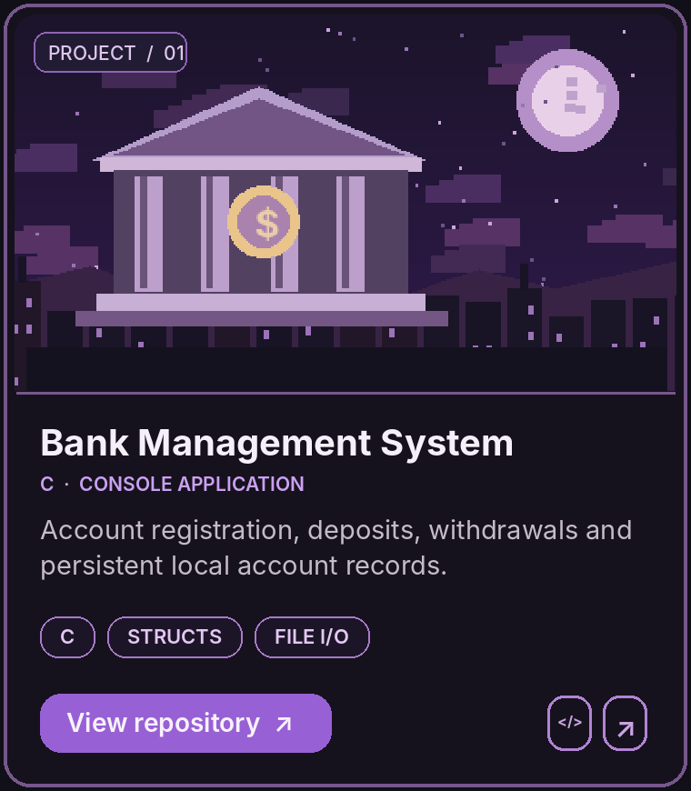
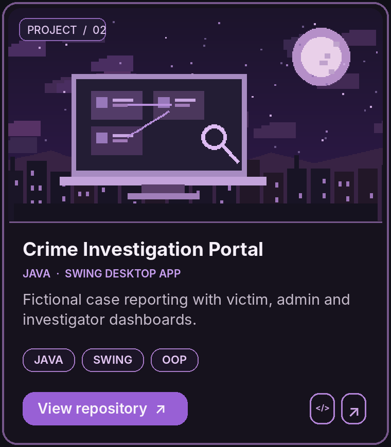

  

  
  
  

  
  
  

---

## ✦ About Me

I'm **Md Saimum Islam Fahad**, a **Computer Science & Engineering undergraduate at North South University** in Dhaka, Bangladesh.

I enjoy turning programming concepts into working software, understanding how systems fit together, and improving one project at a time. My interests include **software engineering, mathematics, AI/ML, and robotics**.

Outside coding, my experience tutoring students has strengthened my communication, problem-solving, and ability to explain technical ideas clearly.

## 🛠 Tech Stack

### Languages & Markup

  

**Programming:** `C` · `C++` · `Python` · `Java`  
**Markup:** `HTML5`

### IDEs & Developer Tools

  

`Code::Blocks` · `Visual Studio Code` · `IntelliJ IDEA` · `Git` · `GitHub`

### Technical Foundations

`Data Structures` · `Algorithms` · `Object-Oriented Programming` · `Problem Solving` · `Java Swing` · `File Handling`

## 📂 Featured Projects

  
  

<strong>✦ Bank Management System — Features & technical highlights</strong>

A console-based academic banking simulator developed in C.

- Account registration and login
- Balance inquiry, deposits, and withdrawals
- Password changes and transaction checks
- Local binary `.dat` file storage

**Skills:** C structures, functions, control flow, and file I/O.

[View project documentation](https://github.com/saimumfahad-dev/bank-management-system-c)

<strong>✦ Crime Investigation Portal — Features & technical highlights</strong>

A Java Swing desktop prototype for managing fictional crime reports.

- Victim report submission and case IDs
- Admin dashboard and investigator assignment
- Investigator dashboard and case status updates
- Case tracking and local file storage

**Skills:** Java, Swing, OOP, event handling, and file I/O.

[View project and screenshots](https://github.com/saimumfahad-dev/crime-investigation-portal-java)

Both applications are academic prototypes, not production systems.

## ☾ Currently Exploring

- Strengthening data structures, algorithms, and problem-solving skills
- Writing cleaner, more maintainable programs
- Building and documenting complete software projects
- Learning more about AI/ML, mathematics, and robotics

## 📊 GitHub Activity

  

  

Activity cards are provided by an external service and may occasionally be unavailable. Language statistics reflect public repository code, not every language I know.

---

  <strong>✦ Code · Build · Learn ✦</strong> 
  Thanks for visiting my corner of GitHub.

