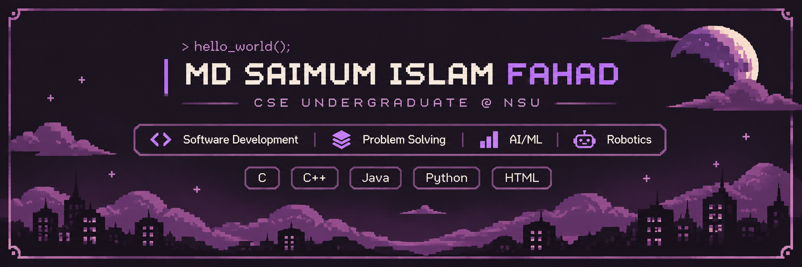

  

  
  
  

## About Me

I'm a **Computer Science & Engineering undergraduate at North South University**, based in Dhaka, Bangladesh. I enjoy building software projects that turn programming concepts into practical, working applications.

My interests include **software engineering, problem solving, mathematics, and AI/ML**. Alongside university, three years of private tutoring have strengthened my communication and mentoring skills.

## Tech Stack

### Languages & Markup

  

**Programming:** `C` · `C++` · `Python` · `Java`  
**Markup:** `HTML5`

### IDEs & Developer Tools

  

`Code::Blocks` · `VS Code` · `IntelliJ IDEA` · `Git` · `GitHub`

### Technical Foundations

`Data Structures` · `Algorithms` · `Object-Oriented Programming` · `Java Swing` · `File Handling` · `Problem Solving`

## Featured Projects

### [Bank Management System](https://github.com/saimumfahad-dev/bank-management-system-c) · C

A console-based academic banking simulator built to practice structured programming and persistent file storage.

**Implemented features**
- Account registration and login
- Balance checks, deposits, and withdrawals
- Password changes and basic transaction validation
- Local account storage using binary `.dat` files

**Skills demonstrated:** C structures, control flow, functions, file I/O, and menu-driven program design.

[**Explore the C project**](https://github.com/saimumfahad-dev/bank-management-system-c)

### [Crime Investigation Portal](https://github.com/saimumfahad-dev/crime-investigation-portal-java) · Java Swing

A desktop academic prototype for filing and managing **fictional** crime reports through separate user interfaces.

**Implemented features**
- Victim report form and generated case IDs
- Administrator dashboard for report review and investigator assignment
- Investigator dashboard for assigned cases and status updates
- Case tracking and local text-file storage

**Skills demonstrated:** Java, Swing GUI development, object-oriented design, event handling, and file I/O.

[**Explore the Java project**](https://github.com/saimumfahad-dev/crime-investigation-portal-java) · [**View application screenshots**](https://github.com/saimumfahad-dev/crime-investigation-portal-java/tree/main/screenshots)

Both projects are educational prototypes, not production banking or law-enforcement systems.

## Currently Working On

- Strengthening data structures, algorithms, and problem-solving skills
- Writing cleaner, more maintainable code
- Building and documenting more complete software projects
- Exploring the mathematical foundations of AI/ML

## GitHub Activity

  

  

These third-party cards may occasionally be unavailable. Language statistics reflect code in public repositories, not every language I know.

---

<strong>Code · Build · Learn</strong>

